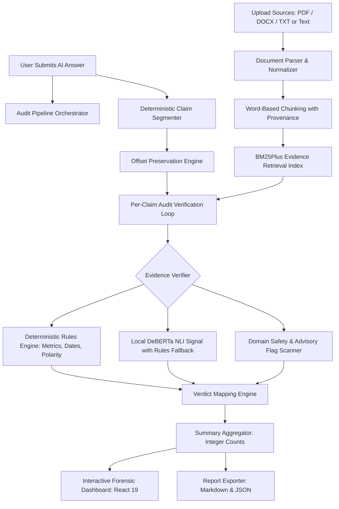

# Second Opinion — Evidence-Grounded AI Answer Auditor

**An evidence-grounded AI answer auditor designed to verify AI-generated answers against user-provided reference sources (PDF, DOCX, TXT) and surface transparent, claim-level findings.**

---

## 1. Overview

Second Opinion is an evidence-first auditing tool for students, researchers, and developers who need to inspect AI-generated text against authoritative reference materials such as textbooks, research papers, policy documents, and technical reports. 

Instead of treating an AI response as a monolithic block or relying on ungrounded generative critiques, Second Opinion decomposes the answer into discrete claims, retrieves candidate evidence passages from the user's uploaded sources, evaluates each claim using deterministic rules and natural language inference (NLI), and surfaces transparent, verifiable evidence passages.

### Core Principles

1. **Evidence-Grounded Verification:** Every claim is audited strictly against the documents provided by the user.
2. **Absence of Evidence is Not Falsity:** A claim unsupported by the supplied source material is classified as `NOT_ESTABLISHED_BY_SOURCE`, never automatically assumed to be false (`CONTRADICTED_BY_SOURCE`).
3. **Strict Offset Preservation:** Claim boundaries preserve exact zero-based Unicode code-point offsets (`answer[start:end] == claim.text`), ensuring highlighting in the original answer without reflowing or mutation.
4. **Transparent Summaries:** The audit report surfaces exact integer counts for each verdict category rather than masking individual discrepancies behind a single aggregated percentage.
5. **Zero Budget & 100% Offline Capable:** The core audit operates with ₹0 cost, zero paid API dependencies, and no externally hosted language models.
6. **Transient & Privacy-First:** Operates entirely in-memory with no database, no authentication, and no persistent server-side audit logs.

---

## 2. Verdict Framework

Second Opinion maps every extracted claim to one of four canonical verdicts:

| Verdict | Meaning | Review Priority |
|---|---|---|
| `SUPPORTED_BY_SOURCE` | Directly substantiated by factual evidence, matching numerical values, dates, or semantic entailment in the source text. | Low |
| `CONTRADICTED_BY_SOURCE` | Directly clashing with source evidence (numerical mismatch, conflicting dates, or polarity/negation contradiction). | High |
| `NOT_ESTABLISHED_BY_SOURCE` | The provided sources do not contain sufficient evidence to substantiate or contradict the claim. | Medium |
| `AMBIGUOUS_OR_CONFLICTING` | The claim contains internal ambiguities, or multiple candidate passages provide conflicting accounts. | Medium |

In addition, domain-specific advisory flags (`medical`, `legal`, `financial`) are detected and isolated as review tags without distorting factual source verdicts.

---

## 3. System Architecture & Workflow



---

## 4. Key Features

- **Multi-Format Source Ingestion:**
  - Plain Text (`.txt`) with character and line offset tracking.
  - Portable Document Format (`.pdf`) using `pypdf`, preserving 1-based page numbers.
  - Microsoft Word (`.docx`) using `python-docx`, extracting paragraph and tabular text.
- **Provenance-Aware Chunking:** Word-based sliding windows (~120–220 words with 40-word overlap) preserving source IDs, file names, page numbers, and exact character offsets.
- **Deterministic Claim Segmentation:** Regex-based boundary detection with abbreviation guards (e.g., *Dr.*, *U.S.*, *e.g.*), decimal guards (*$500.50*), quotation preservation, and strict Unicode code-point indexing.
- **Robust Candidate Retrieval:** Uses `BM25Plus` from `rank-bm25` to prevent negative IDF collapse on small reference corpora, with custom tokenization preserving currency, numbers, and dates.
- **Deterministic Rules Engine:**
  - Numerical and currency mismatch detection (e.g., claim says *$1,000*, source says *$500*).
  - Date and year discrepancy detection (e.g., claim says *2024*, source says *2025*).
  - Polarity and negation clash detection (e.g., *cannot purchase* vs *can purchase*).
- **Optional Local DeBERTa NLI with Graceful Fallback:**
  - Evaluates premise-hypothesis pairs against `microsoft/deberta-base-mnli`.
  - Dynamic runtime label mapping (`entailment`, `contradiction`, `neutral`).
  - Seamlessly falls back to `rules_only` mode (`MODEL_FALLBACK_RULES_ONLY`) if PyTorch/Transformers are not installed or resources are constrained.
- **Web URL Ingestion & Strict SSRF Defense:**
  - Direct web URL ingestion tab with multi-URL support (capped at 5 URLs).
  - Pre-flight DNS validation blocking private, loopback, and cloud instance metadata IPs (`169.254.169.254`).
  - Chunk-by-chunk stream byte cap (2 MiB), gzip bomb protection, and polite `robots.txt` enforcement.
- **Source Fit & Domain Mismatch Defense:**
  - Pre-audit lexical coverage grading (`RELEVANT`, `PARTIALLY_RELEVANT`, `OFF_TOPIC`).
  - Flags domain mismatches with an amber advisory banner, preventing false contradictions on uncovered topics.
- **Evidence Provenance & Multi-Source Corroboration:**
  - Badges distinguish `User File`, `Web URL`, `Wikipedia`, `arXiv`, `Crossref`, and `Web Search` sources.
  - Corroborating independent sources counter prevents reliance on isolated web claims.
- **Calm Forensic Dashboard UI:**
  - Interactive original answer viewer with color-coded, clickable claim highlights.
  - Side-by-side evidence passage inspector displaying source quotes, page provenance, and retrieval rankings.
  - One-click sample loader for rapid demonstration.
  - Instant Markdown (`.md`) and structured JSON report downloads.

---

## 5. Tech Stack

| Layer | Technology | Purpose | Verification Status |
|---|---|---|---|
| **Backend Framework** | Python 3.11+ / 3.14.2 + FastAPI | Async REST API, OpenAPI docs | Verified (99/99 offline tests pass) |
| **Data Validation** | Pydantic v2 | Strict schema enforcement | Verified |
| **Document Parsers** | `pypdf`, `python-docx` | PDF & DOCX text extraction | Verified |
| **Retrieval Engine** | `rank-bm25` (`BM25Plus`) | Corpus indexing & evidence search | Verified |
| **Local NLI** | `microsoft/deberta-base-mnli` | Zero-shot premise-hypothesis inference | Verified with rules-only fallback |
| **Frontend Framework** | React 19 + TypeScript + Vite 6 | Forensic audit dashboard | Verified (Clean build in ~280ms) |
| **Styling & UI** | Tailwind CSS 4 + Lucide React | Modern typography & accessible badges | Verified |
| **Testing** | pytest, httpx, Vitest | Unit, hostile, & integration suites | Verified (99 offline + 13 real URL tests pass) |

---

## 6. Project Structure

```text
BNB'26 Second Option/
├── backend/
│   ├── app/
│   │   ├── api/
│   │   │   └── audit_routes.py       # Health check, POST /api/audits, export endpoints
│   │   ├── services/
│   │   │   ├── audit_service.py       # Pipeline orchestrator & Markdown generator
│   │   │   ├── citation_checker.py    # Substantive quote alignment & claim coverage
│   │   │   ├── claim_segmenter.py     # Deterministic sentence & offset segmentation
│   │   │   ├── cost_guard.py          # Query sanitization & query budget caps
│   │   │   ├── document_parser.py     # TXT, PDF, DOCX parsers
│   │   │   ├── nli_verifier.py        # Local DeBERTa loader with rules-only fallback
│   │   │   ├── retriever.py           # BM25Plus retrieval engine
│   │   │   ├── rules_verifier.py      # Numerical, date, & polarity conflict rules
│   │   │   ├── safety_flags.py        # Medical, legal, & financial advisory scanner
│   │   │   ├── source_chunks.py       # Word-based chunking with page provenance
│   │   │   ├── source_fit.py          # Domain alignment & lexical coverage scoring
│   │   │   ├── summary_service.py     # Integer summary count aggregator
│   │   │   ├── url_fetcher.py         # URL scraping with SSRF & gzip bomb defenses
│   │   │   ├── validation.py          # Input size, file count, & character limits
│   │   │   ├── verdict_mapper.py      # Canonical verdict assignment
│   │   │   └── web_evidence/          # Keyless Wikipedia/arXiv/Crossref search chain
│   │   ├── config.py                  # AuditConfig & environment settings
│   │   ├── errors.py                  # SecondOpinionError hierarchy & HTTP handlers
│   │   ├── main.py                    # FastAPI application entrypoint
│   │   └── schemas.py                 # Pydantic v2 request/response contracts
│   └── tests/
│       ├── fixtures/                  # Synthetic test policy & dates fixtures
│       ├── test_audit_api.py          # End-to-end API integration tests
│       ├── test_benchmark_suite.py    # 20-case core benchmark evaluation suite
│       ├── test_citation_checker.py   # Citation verification unit tests
│       ├── test_cost_guard.py         # Query privacy & budget cap tests
│       ├── test_health.py             # Health check & schema tests
│       ├── test_hostile_server.py     # Local hostile server SSRF & bomb attack tests
│       ├── test_offsets.py            # Claim segmentation & offset invariant tests
│       ├── test_parsers.py            # PDF, DOCX, TXT parser tests
│       ├── test_pipeline_stress.py    # 15 pipeline edge cases & concurrency tests
│       ├── test_real_urls.py          # Polite real public URLs integration suite
│       ├── test_retriever.py          # BM25Plus retrieval ranking tests
│       ├── test_source_fit.py         # Source fit lexical overlap tests
│       ├── test_url_fetcher.py        # URL ingestion unit tests
│       ├── test_verdict_mapper.py     # Verdict mapping & safety flag tests
│       └── test_web_evidence.py       # Keyless provider chain tests
├── contracts/
│   └── openapi.json                   # Exported OpenAPI 3.1.0 schema
├── examples/
│   ├── example_answer.txt             # Sample AI answer for testing
│   ├── example_source.txt             # Sample reference policy document
│   └── expected_findings.json         # Reference findings assertion
├── frontend/
│   ├── src/
│   │   ├── api/
│   │   │   └── client.ts              # Strongly typed API client & export helpers
│   │   ├── components/
│   │   │   ├── AppHeader.tsx          # Navigation, status indicators, reset button
│   │   │   ├── AuditForm.tsx          # Multi-input form with sample loader
│   │   │   ├── AuditSummary.tsx       # Forensic overview, count badges, export bar
│   │   │   ├── ClaimList.tsx          # Claim finding cards with priority badges
│   │   │   ├── EvidencePanel.tsx      # Sticky evidence passage inspector
│   │   │   ├── FileDropzone.tsx       # Drag-and-drop PDF/DOCX/TXT uploader
│   │   │   ├── OriginalAnswerViewer.tsx # Interactive highlight span viewer
│   │   │   └── VerdictBadge.tsx       # Reusable verdict & priority badges
│   │   ├── lib/
│   │   │   └── offsets.ts             # Character offset span slicing utilities
│   │   ├── tests/
│   │   │   ├── offsets.test.ts        # Frontend span slicing unit tests
│   │   │   └── verdict-labels.test.ts # Verdict badge configuration tests
│   │   ├── App.tsx                    # Main stateful dashboard workspace
│   │   ├── index.css                  # Tailwind styles
│   │   └── main.tsx                   # React root entrypoint
│   ├── package.json
│   ├── tsconfig.json
│   └── vite.config.ts                 # Vite bundler configuration & API proxy
├── scripts/
│   ├── check_model.py                 # Verifies local DeBERTa model availability
│   ├── export_openapi.py              # Generates contracts/openapi.json
│   └── run_smoke_test.py              # CLI end-to-end audit smoke test
├── .env.example                       # Environment variable template
├── CHANGELOG.md                       # Phase-by-phase implementation log
├── IDEAS_FOR_APPROVAL.md              # Proposal register
├── PROJECT_CONTEXT.md                 # Authoritative project specification
└── pyproject.toml                     # Python package & dependency metadata
```

---

## 7. Getting Started

### Prerequisites

- **Python:** 3.11 or newer (tested on Python 3.14.2)
- **Node.js:** v20+ LTS or v24+ (tested on Node.js v24.20.0)
- **Package Manager:** `npm` (tested on npm 11.19.0)

### 1. Clone the Repository

```bash
git clone https://github.com/sheldonvibinonmusic/ViSiON-QUEST_college_round.git
cd "BNB'26 Second Option"
```

### 2. Backend Setup

Create and activate a Python virtual environment, then install dependencies:

```bash
# Windows PowerShell
python -m venv .venv
.\.venv\Scripts\Activate.ps1
pip install -e .

# Linux / macOS
python3 -m venv .venv
source .venv/bin/activate
pip install -e .
```

To install testing dependencies as well:
```bash
pip install pytest httpx
```

### 3. Frontend Setup

```bash
cd frontend
npm install
cd ..
```

### 4. Configuration

Copy the example environment configuration:

```bash
cp .env.example .env
```

*Note: No API keys are required for the core auditing pipeline.*

---

## 8. Running the Application

### Start the Backend

From the project root:

```bash
# Windows
.\.venv\Scripts\uvicorn backend.app.main:app --reload --port 8000

# Linux / macOS
uvicorn backend.app.main:app --reload --port 8000
```

The backend API will be available at `http://localhost:8000`.
Interactive API documentation is accessible at `http://localhost:8000/docs`.

### Start the Frontend

In a separate terminal:

```bash
cd frontend
npm run dev
```

The React dashboard will be running at `http://localhost:5173`. Requests to `/api/*` are automatically proxied to the backend on port 8000.

---

## 9. Verification & Testing

All test suites and verification scripts have been executed and verified on the local host:

### 1. Backend Pytest Suite (99 Offline Tests + Live Integration Suite)

```bash
# Run deterministic offline test suite (99 tests)
.\.venv\Scripts\pytest -m "not integration" -v

# Run full suite including live URL integration tests (100 items)
.\.venv\Scripts\pytest -v
```
*Output: 99 offline tests passed in ~2.4s (covers SSRF blocks, redirect loops, hostile payload parsing, provider fallback chains, and offset calculations).*

### 2. Frontend Vitest & Lint Suite (5 Tests)

```bash
# Run unit & component tests
npm --prefix frontend test

# Run high-performance linter
npx --prefix frontend oxlint
```
*Output: 5 passed in ~0.2s; 0 warnings, 0 errors.*

### 3. Frontend Production Build

```bash
npm --prefix frontend run build
```
*Output: TypeScript typecheck clean, production bundle compiled with zero errors.*

### 4. End-to-End CLI Smoke Test

```bash
.\.venv\Scripts\python scripts/run_smoke_test.py
```
*Output: 100% of pipeline assertions pass in <0.05s; validates `SUPPORTED_BY_SOURCE`, `CONTRADICTED_BY_SOURCE`, and `NOT_ESTABLISHED_BY_SOURCE` in a single run.*

### 5. Export OpenAPI Contract

```bash
.\.venv\Scripts\python scripts/export_openapi.py
```
*Output: Writes active schema to `contracts/openapi.json`.*

---

## 10. API Reference

### `GET /api/health`
Returns system status, active version, configured verifier mode, and budget status (`free_tier`).

**Sample Response:**
```json
{
  "status": "ok",
  "version": "0.6.0",
  "budget_status": "free_tier",
  "verifier_mode": "rules_only"
}
```

### `POST /api/audits`
Executes an audit over submitted text and/or files.

- **Content-Type:** `multipart/form-data`
- **Fields:**
  - `answer` (string, required): AI-generated answer text to audit (≤ 40,000 characters).
  - `source_text` (string, optional): Pasted reference material.
  - `files` (files, optional): Up to 5 uploaded `.pdf`, `.docx`, or `.txt` files (≤ 10 MiB each).
- **Response:** `AuditResponse` JSON containing `findings`, `summary`, `sources`, and `warnings`.

### `POST /api/audits/export/markdown`
Generates a formatted Markdown report from an existing `AuditResponse` payload.

- **Content-Type:** `application/json`
- **Body:** Full `AuditResponse` JSON object.
- **Response:** Raw Markdown text suitable for download or clipboard copying.

---

## 11. Security & Privacy

- **Zero Data Retention:** Second Opinion operates as an in-memory transient processor. Neither the submitted answer nor the uploaded documents are persisted to a database or disk.
- **No Untrusted Overrides:** Uploaded documents are treated purely as inert textual evidence. Prompt injection attempts embedded within uploaded documents cannot override system verification logic.
- **No Telemetry or Tracking:** No user tracking, analytics, or external API calls are dispatched during core audits.
- **No Hard-Coded Secrets:** Configuration uses `.env.example` with non-secret default values.

---

## 12. Roadmap & Deferred Work

- [x] Phase 1: Environment scaffold, configuration, and health endpoints.
- [x] Phase 2: PDF, DOCX, TXT document parsers and deterministic claim segmenter.
- [x] Phase 3: BM25Plus retrieval, deterministic rules verifier, safety flags, and verdict mapper.
- [x] Phase 4: Audit pipeline orchestrator, multipart API, and Markdown report export.
- [x] Phase 5: Interactive React 19 forensic dashboard with claim highlighting and sample loader.
- [x] Phase 6: End-to-end smoke tests, OpenAPI schema export, and verified documentation.
- [ ] *Deferred / Future:* Dense semantic embeddings (optional hybrid retrieval).
- [ ] *Deferred / Future:* Token-level hallucination span detection using LettuceDetect.
- [ ] *Deferred / Future:* External web verification mode (strictly separated from local source mode).
- [ ] *Deferred / Future:* OCR support for scanned image-only PDFs (`tesseract-ocr`).

---

## 13. License

This project is licensed under the MIT License. See `LICENSE` for details.
