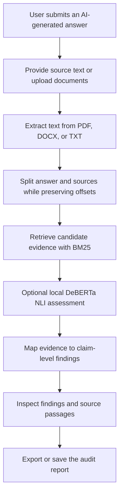

# Second Opinion

**An evidence-grounded AI answer auditor designed to compare AI-generated answers with user-provided source material.**

## Overview

Second Opinion is a planned tool for students and researchers who want to inspect AI-generated answers against textbooks, research papers, reports, or reference documents. The intended workflow separates claims supported by the supplied sources from claims contradicted by them, claims the sources do not establish, and cases where the evidence is ambiguous. The application has not yet been implemented or tested, so the capabilities described as planned below are not currently available in a working release.

## Key Features

No application features are currently confirmed as implemented. This section will be updated when features have been built and verified through testing.

## Demo

[ADD: screenshot/GIF/live link]

## How It Works

A working audit pipeline is not available yet. The following diagram describes the **planned workflow**, not an implemented system:

## Tech Stack

No application runtime stack has been verified as installed or used by an implementation yet. The intended stack is listed under Roadmap.

| Technology | Purpose |
|---|---|
| Not yet confirmed as implemented | No runtime dependency or framework can currently be described as part of a working application. |

## Project Structure

The application repository and source tree have not yet been created. Add the actual project structure here after the initial implementation files have been committed.

[ADD: actual project structure after files are committed]

## Getting Started

The project does not yet have verified installation or run instructions. The placeholders below must be replaced after a clean setup has been tested.

### Prerequisites

[ADD: verified prerequisites and required runtime versions]

### Clone

[ADD: repository clone URL]

### Install

[ADD: verified installation commands]

### Environment variables

[ADD: verified environment-variable names and `.env.example` path]

Do not place secrets in the frontend or commit API keys to the repository. The intended core audit should not require an external API key.

### Run

[ADD: verified run commands]

## Usage

[ADD: example input and output from a tested audit]

## Roadmap

The following items are planned requirements or proposed implementation work. They are not available features until implemented and tested.

### Planned stack

- [ ] Frontend: React, TypeScript, and Vite.
- [ ] Backend: Python and FastAPI.
- [ ] Evidence retrieval: BM25.
- [ ] Text splitting: deterministic sentence/paragraph splitting that preserves source offsets.
- [ ] Document inputs: PDF through `pypdf`, DOCX through `python-docx`, and plain text.
- [ ] Optional local assessment signal using DeBERTa natural-language inference; `microsoft/deberta-base-mnli` is the proposed model identifier and still requires integration and testing.
- [ ] Keep the core source-grounded audit usable without a paid API or externally hosted language model.

### Planned audit behaviour

- [ ] Accept an AI-generated answer and user-provided reference text or supported documents.
- [ ] Extract source text and preserve document identity and page or section information where available.
- [ ] Identify answer claims and preserve original-text offsets for highlighting.
- [ ] Retrieve candidate evidence passages from supplied sources.
- [ ] Keep the following outcomes distinct: supported by the source, contradicted by the source, not established by the source, and ambiguous or conflicting evidence.
- [ ] Treat NLI output as an assessment signal, not as proof of truth or a guaranteed probability.
- [ ] Show the original answer, claim-level findings, relevant source passages, explanations, and warnings.
- [ ] Show a transparent summary that does not conceal serious individual findings behind a single accuracy percentage.
- [ ] Provide a way to download or save the audit report.
- [ ] Handle missing evidence without automatically labelling a claim false.
- [ ] Provide clear errors for empty input, unreadable documents, unsupported files, oversized inputs, and failed audits.
- [ ] Add and run a small labelled evaluation set before making performance claims.

### Optional future work

- [ ] Consider external-web verification as a separate mode that does not silently mix outside evidence with user-provided source evidence.
- [ ] Consider embedding-based retrieval if evaluation shows BM25 misses relevant paraphrased passages.
- [ ] Consider finer-grained span detection using a specialised model such as LettuceDetect.
- [ ] Consider multilingual support after selecting and evaluating appropriate models.
- [ ] Consider OCR for scanned PDFs only after implementing and testing it.
- [ ] Attempt public deployment only after the local application works reliably and a suitable free hosting option has been verified.

## Contributing

Contribution instructions have not yet been established. Before contributing, check this README for the current project scope. Add the verified development, formatting, testing, and pull-request workflow here after the repository is created.

[ADD: contribution workflow and test commands]

## License

[ADD: project license]

## Acknowledgements

No third-party API or open-source runtime dependency has been confirmed as used by a working application. The proposed tools and libraries are listed in the Roadmap; this section should be updated after dependencies are selected, installed, and used.
